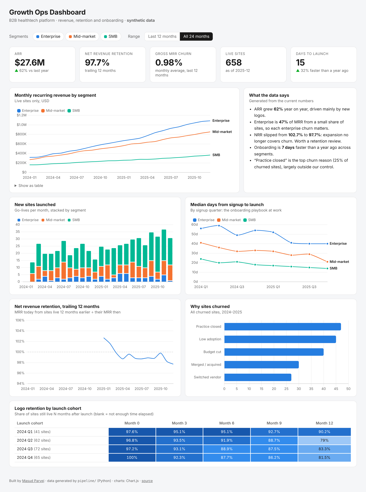
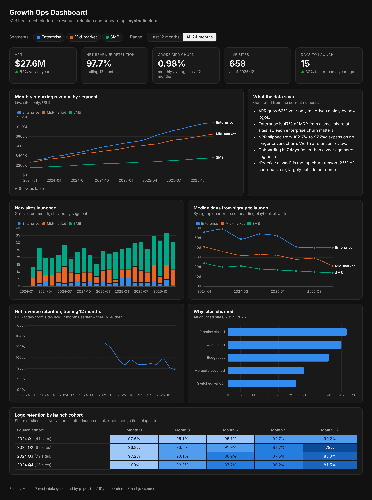

# Growth Ops Dashboard

[](https://github.com/mprantikk/growth-ops-dashboard/actions/workflows/ci.yml)


**[▶ Open the live dashboard](https://mprantikk.github.io/growth-ops-dashboard/)**

A growth-operations dashboard for a B2B healthtech platform: ARR, net revenue retention, churn, onboarding speed and cohort retention, the numbers a growth or launch team reviews every month. A Python pipeline computes every metric from site-level data; a single static page renders it. All data is synthetic.



## What it shows

| View | Question it answers |
|---|---|
| **KPI tiles** | ARR and growth, NRR, gross MRR churn, live sites, days to launch |
| **MRR by segment** | Where revenue comes from, with a table view |
| **New sites launched** | Is go-live volume keeping up with sales? |
| **Days from signup to launch** | Is onboarding getting faster, per segment? |
| **NRR trend** | Does expansion still cover churn? |
| **Churn reasons** | What we can and can't control |
| **Cohort heatmap** | How many sites are still live 3, 6, 9, 12 months after launch |
| **What the data says** | Plain-English takeaways generated from the current numbers |

Filters for segment and time range sit above the charts; colours stay tied to each segment when filtering. Dark mode follows the system setting, and every line is labelled directly so nothing relies on colour alone.

## Metric definitions

| Metric | Definition |
|---|---|
| MRR | Sum of monthly recurring revenue across live sites |
| NRR (12m) | MRR now from sites live 12 months ago ÷ their MRR then (expansion, contraction and churn included; new sites excluded) |
| Gross MRR churn | MRR lost to sites that churned in the month ÷ MRR at the start of the month |
| Days to launch | Median days from signup to go-live, by signup quarter |
| Logo retention | Share of a launch cohort still live N months after launch |

## How it works

```
pipeline/generate.py ──► site-level data (seeded) ──► pipeline/metrics.py ──► data/metrics.json ──► index.html
```

- `pipeline/` is plain Python (standard library only). `python -m pipeline.metrics` rebuilds the JSON.
- `index.html` is a single static page: no build step, hosted on GitHub Pages.
- **Tests** check each metric against hand-calculated cases (NRR ignores new logos, churn uses starting MRR, cohort maths), and CI fails if the committed JSON drifts from what the pipeline produces.

## Run locally

```bash
git clone https://github.com/mprantikk/growth-ops-dashboard.git
cd growth-ops-dashboard
python -m pipeline.metrics        # regenerate data/metrics.json
python -m http.server 8000        # then open http://localhost:8000
pytest -v
```

<details><summary>Dark mode</summary>


</details>

Built by [Masud Parvej](https://mprantikk.github.io/).
